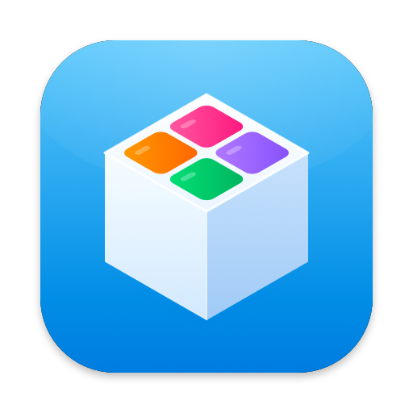

<p align="center">
  
</p>

<h1 align="center">MiniBox</h1>

<p align="center">
  Ghi chú, thời khoá biểu, Pomodoro, trắc nghiệm, nghe nhạc… gói gọn trong một app macOS nhỏ gọn.<br>
  Viết bằng Swift & SwiftUI · lưu dữ liệu trên máy · miễn phí.
</p>

<p align="center">
  <a href="https://github.com/not2pixel/MiniBox/releases/latest"></a>
  
  
  <a href="LICENSE"></a>
</p>

---

## Cài đặt

**Cách 1 — một dòng lệnh (khuyên dùng).** Mở **Terminal** và dán:

```bash
curl -fsSL https://raw.githubusercontent.com/not2pixel/MiniBox/main/install.sh | bash
```

Trình cài đặt sẽ tải bản mới nhất từ [Releases](https://github.com/not2pixel/MiniBox/releases), cài vào `/Applications` và mở MiniBox.

**Cách 2 — tải thủ công.** Vào [Releases](https://github.com/not2pixel/MiniBox/releases/latest):

- tải `Install-MiniBox.command`, **chuột phải → Mở** (lần đầu macOS sẽ hỏi vì tệp chưa ký bằng tài khoản Apple Developer), hoặc
- tải `MiniBox.zip`, giải nén và kéo `MiniBox.app` vào thư mục Applications. Nếu macOS chặn, **chuột phải vào app → Mở**.

**Yêu cầu:** macOS 14 Sonoma trở lên · chạy trên cả Mac Apple Silicon lẫn Intel.

### Cập nhật

MiniBox tự kiểm tra bản mới trên GitHub mỗi ngày và hỏi bạn trước khi cập nhật. Bạn cũng có thể vào menu **MiniBox → Kiểm tra cập nhật…** hoặc **Cài đặt → Chung → Cập nhật**. App sẽ tự tải, thay bản cũ và mở lại — dữ liệu được giữ nguyên.

---

## Tính năng

| | |
|---|---|
| 📝 **Ghi chú** | Danh mục tuỳ chỉnh (biểu tượng & màu), checklist, ghim, nhắc nhở theo ngày giờ, tìm kiếm. |
| 🗓️ **Thời khoá biểu** | Lưới tuần Thứ 2 → Chủ nhật như app Lịch: kéo để dời, kéo mép để đổi độ dài, giờ nghỉ, nhắc trước giờ học. |
| ⏱️ **Pomodoro** | Tập trung / nghỉ ngắn / nghỉ dài, đếm ngược trên thanh menu, thống kê trong ngày. |
| 🎓 **Trắc nghiệm** | Prompt mẫu để AI soạn câu hỏi, dán kết quả là tạo bộ câu hỏi, sắp xếp câu, làm bài có giải thích. |
| ✨ **Trợ lý AI** | Claude, ChatGPT, Gemini, DeepSeek, Grok, Perplexity… mở ngay trong app hoặc Safari. |
| 🗂️ **Thư viện** | Kho tài liệu riêng kiểu Finder, trình xem PDF (tìm chữ, nhớ trang), ảnh, video, văn bản. |
| 🎮 **Trò chơi** | Chơi game theo phiên có hẹn giờ, giới hạn mỗi ngày, quét game PlayCover. |
| 🎵 **Phát nhạc** | Giao diện kiểu Spotify: trang chủ gợi ý, mix theo gu, bảng xếp hạng, tìm trên YouTube Music & SoundCloud, lưu offline, lời bài hát chạy theo nhạc. |
| 💬 **Discord** | Hiện “Đang nghe…”, “Đang học…”, “Đang chơi…” lên Discord (Rich Presence). |
| 🌗 **Giao diện** | Theo phong cách Apple, sáng / tối / tự động, bật tắt từng mục trên sidebar. |

### Phím tắt

| Phím | Tác dụng |
|---|---|
| `⌘N` | Ghi chú mới |
| `⇧⌘F` | Bắt đầu / tạm dừng Pomodoro |
| `⇧⌘K` | Mở trợ lý AI |
| `⌘5` `⌘6` `⌘7` `⌘8` `⌘9` | Thời khoá biểu · Phát nhạc · Trò chơi · Thư viện · Trắc nghiệm |
| `⌘0` | Pomodoro |
| `⌥Space` | Phát / tạm dừng nhạc |
| `⌘,` | Cài đặt |

---

## Dữ liệu & quyền riêng tư

- Mọi dữ liệu nằm trên máy bạn tại `~/Library/Application Support/MiniBox/` (ghi chú, trắc nghiệm, thời khoá biểu, thư viện tài liệu, nhạc đã lưu). Không có tài khoản, không có máy chủ riêng.
- Cài đặt nằm trong `UserDefaults` của app (`com.products.minibox`).
- MiniBox chỉ kết nối mạng khi bạn dùng tính năng cần mạng: trợ lý AI, tìm/nghe nhạc online, lời bài hát (LRCLIB), Discord, kiểm tra cập nhật (GitHub).

Gỡ cài đặt: xoá `MiniBox.app` và thư mục `~/Library/Application Support/MiniBox/`.

---

## Build từ mã nguồn

Chỉ cần **Command Line Tools** (không cần Xcode):

```bash
xcode-select --install          # nếu chưa có
git clone https://github.com/not2pixel/MiniBox.git
cd MiniBox
./build.sh --install            # build universal, cài vào /Applications
```

- `./build.sh` tạo `build/MiniBox.app` và `build/MiniBox.zip`.
- `swift Scripts/make_icon.swift` vẽ lại icon (`Resources/AppIcon.icns`).
- Cấu trúc mã nguồn: xem [docs/ARCHITECTURE.md](docs/ARCHITECTURE.md).

### Phát hành bản mới

```bash
brew install gh && gh auth login   # một lần
# thêm mục "## [1.1.0]" vào CHANGELOG.md, rồi:
Scripts/release.sh 1.1.0
```

Script sẽ đặt số phiên bản, build, tạo tag, push và tạo GitHub Release kèm `MiniBox.zip` + `Install-MiniBox.command`. Người dùng bản cũ sẽ nhận được thông báo cập nhật.

---

## Ghi chú về các dịch vụ bên ngoài

- **Nhạc online** dùng giao diện web không chính thức của YouTube Music và SoundCloud, cùng công cụ mã nguồn mở [yt-dlp](https://github.com/yt-dlp/yt-dlp) (tải về khi bạn bấm cài, không đóng gói sẵn). Các dịch vụ này có thể thay đổi bất cứ lúc nào. Chỉ tải nội dung bạn có quyền sử dụng.
- **Lời bài hát** từ [LRCLIB](https://lrclib.net) (miễn phí, mã nguồn mở).
- **Logo trợ lý AI** từ [LobeHub Icons](https://github.com/lobehub/lobe-icons) (MIT). Tên và logo thuộc về chủ sở hữu tương ứng.
- **Discord Rich Presence** cần một Application ID miễn phí — hướng dẫn trong Cài đặt → Discord.

MiniBox là dự án cá nhân, không liên kết với Apple, Spotify, Google, SoundCloud, Discord hay các nhà cung cấp AI.

## Giấy phép

[MIT](LICENSE)
